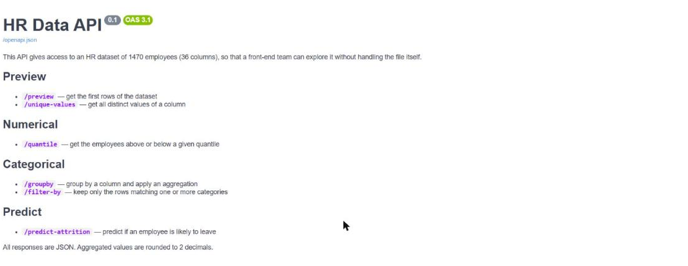

# HR Data API

A REST API that exposes an HR dataset of 1470 employees (36 columns) and a
trained attrition model, so that a front-end team can explore the data without
handling the file itself.

Built with FastAPI, pandas and scikit-learn, packaged with Docker.

**Live API: [hr-data-api-j9yt.onrender.com/docs](https://hr-data-api-j9yt.onrender.com/docs)**
The service runs on a free instance: the first call may take 30 to 50 seconds
while it wakes up.



## Endpoints

| Method | Path | Description |
|---|---|---|
| GET | `/` | Check that the API is running |
| GET | `/preview` | First rows of the dataset (`rows`, default 10) |
| GET | `/unique-values` | Distinct values of a column (`column`) |
| GET | `/quantile` | Highest or lowest employees of a numerical column (`column`, `percent`, `top`) |
| POST | `/groupby` | Group by a column and aggregate (`column`, `by_method`) |
| POST | `/filter-by` | Keep the rows matching one or more categories (`column`, `by_category`) |
| POST | `/predict-attrition` | Probability that an employee leaves (`features`) |

Interactive documentation is served at `/docs` once the API is running.

## Run with Docker

```bash
docker build -t ibm-attrition .
docker run --rm --name ibm-api -p 7860:7860 ibm-attrition
```

Then open http://localhost:7860/docs

## Run without Docker

```bash
pip install -r requirements.txt
python app.py
```

## Examples

The 10% best paid employees:

```bash
curl "http://localhost:7860/quantile?column=DailyRate&percent=0.1&top=true"
```

Average values by business travel:

```bash
curl -X POST http://localhost:7860/groupby \
  -H "Content-Type: application/json" \
  -d '{"column": "BusinessTravel", "by_method": "mean"}'
```

## Prediction model

`/predict-attrition` uses a scikit-learn pipeline (standard scaling, one-hot
encoding, logistic regression) trained on the same dataset, with 86% accuracy.
The model is stored in `ibm_attrition_model.joblib` and loaded once at startup.

The request must contain the 31 columns used for training. A missing column
returns a 400 error listing what is missing. The answer gives the prediction
(`"Yes"` or `"No"`) and the probability of leaving, between 0 and 1.

## Project structure

| File | Role |
|---|---|
| `app.py` | the API: endpoints, Pydantic models, documentation |
| `requirements.txt` | dependencies |
| `Dockerfile` | image definition |
| `ibm_hr_attrition.xlsx` | the dataset |
| `ibm_attrition_model.joblib` | the trained model |
| `docs/swagger.png` | screenshot of the interactive documentation |

## Notes and limits

- Aggregated values are rounded to 2 decimals, so totals may differ slightly
  from the raw data.
- The Excel file is read on each request. The data is static, so this is a
  known cost, not a correctness issue.
- `/filter-by` can return the whole dataset (about 1 MB). There is no
  pagination: the client is expected to handle the volume.
- `scikit-learn` is pinned to 1.7.2, the version used to train the model.
  A different version can load the file but may change the predictions.

## Context

Built during the Jedha Data Fullstack bootcamp, Data Products module.
